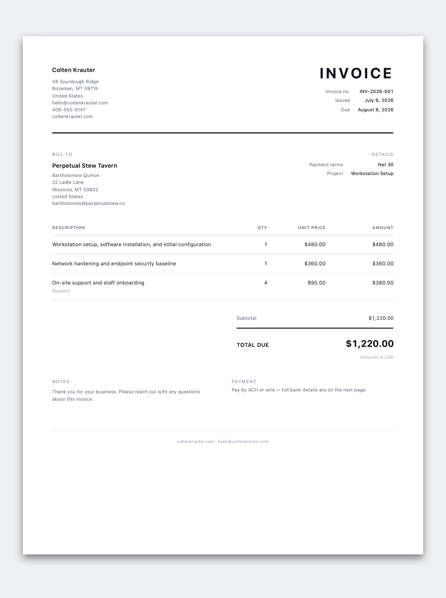
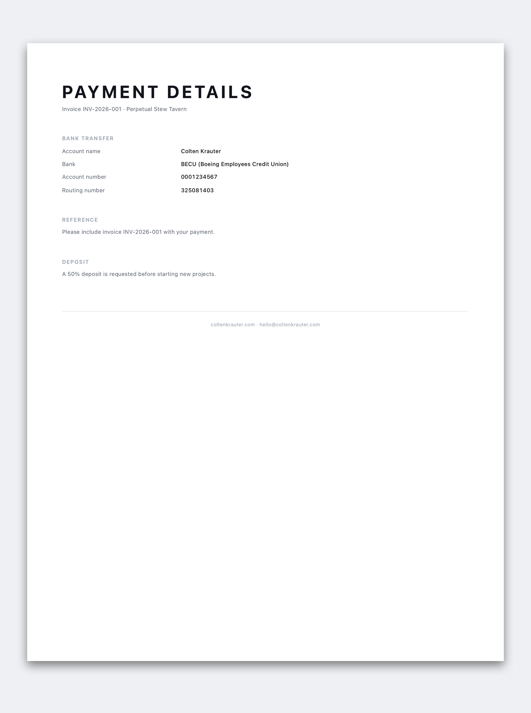

# Folio

[](https://github.com/coltenkrauter/folio/actions/workflows/ci.yml)

A simple, elegant, professional CLI invoice generator. Folio helps a freelancer,
consultant, developer, or small business owner produce clean PDF invoices in a
minute — no accounts, no dashboards, no SaaS login. It runs locally, stores your
data as readable JSON, and renders a PDF you can send to a real client without a
second thought.

<p align="center">
    
</p>

## What it does

- Walks you through creating an invoice with a calm, keyboard-first CLI.
- Saves each invoice as portable, human-readable JSON.
- Renders a polished, professional PDF from that JSON.
- Optionally uses AI to improve line-item wording — only with your approval.

That's the whole product. It does a few things well and stops there.

## Why it exists

Most invoicing tools are heavier than the job requires: accounts to create,
subscriptions to manage, dashboards to click through, and templates that look
like they came from a 2004 accounting package. Folio is the opposite. It is a
local-first CLI that turns a short interview into a document that looks like a
thoughtful designer made it. Your data stays on your machine, in files you can
read, edit, and re-render whenever you want.

## Features

- **Clean CLI flow** — short prompts, sensible defaults, helpful validation.
- **Beautiful PDF output** — minimal, typographically strong, prints well in
  black and white, and puts the total due where nobody can miss it.
- **Readable JSON** — deterministic, alphabetized, diff-friendly, and portable.
- **Reusable defaults** — save your business details once with `folio init`.
- **Optional AI wording** — rewrite vague line items into clear, client-facing
  descriptions, with mandatory approval for every change.
- **Local-first & private** — no accounts, no telemetry, no surprise network
  calls. AI is the only feature that reaches the internet, and only when you ask.
- **Accurate money math** — integer minor-unit arithmetic, so the figures always
  add up.

## Installation

Folio requires **Node.js 18.18+** and uses **pnpm**.

```bash
pnpm install
pnpm build
```

That compiles the CLI to `dist/`. To get a `folio` command on your `PATH`, link
it once from the repo:

```bash
npm link        # adds a global `folio`; undo later with `npm unlink -g folio`
```

Don't want to link? Run it straight from the repo instead — `pnpm start`
(e.g. `pnpm start create`) or `node dist/cli.js create` work exactly the same.

Folio renders PDFs with headless Chromium. If you don't already have a browser
Folio can drive, install one:

```bash
pnpm dlx playwright install chromium
```

You can also point Folio at an existing Chrome/Chromium binary with the
`FOLIO_CHROMIUM_PATH` environment variable. Run `folio doctor` at any time to
see what's set up and what's optional.

## Quick start

Run `folio` with no arguments to open an interactive menu that walks you through
everything — create, render, preview, settings, and a setup check:

```bash
folio           # interactive menu; just pick what you want to do
```

Prefer to jump straight to a command? They all work directly:

```bash
folio init      # save your reusable business details
folio create    # build an invoice: writes JSON + PDF
```

The output looks like this:

```
✓ Saved invoice JSON → invoices/INV-2026-001-perpetual-stew-tavern.json
✓ Saved PDF → invoices/INV-2026-001-perpetual-stew-tavern.pdf
```

## CLI commands

Run `folio` on its own for an interactive menu of everything below, or call any
command directly:

| Command                  | What it does                                                       |
| ------------------------ | ----------------------------------------------------------------- |
| `folio init`             | Create local config and save reusable business details.           |
| `folio create`           | Interactively create an invoice (JSON + PDF).                     |
| `folio create --ai`      | Same, but offer AI help with line-item wording (asks first).      |
| `folio render <file>`    | Validate an invoice JSON file and regenerate its PDF.             |
| `folio preview <file>`   | Write a self-contained HTML preview (no browser needed).          |
| `folio config`           | Show saved defaults (`--edit` to change them).                   |
| `folio doctor`           | Check your environment and see what's optional.                  |

## Creating an invoice

`folio create` collects everything an invoice needs:

1. **Business** — your details, reused from config (override anytime).
2. **Client** — who you're billing.
3. **Metadata** — invoice number, dates, currency, terms, PO, project, hours, notes.
4. **Line items** — description, optional bullet `details`, quantity, unit price,
   optional tax rate.
5. **Payment** — instructions, optional ACH/check details, and optional bank/wire
   details, a payment reference, and a deposit note (these add a second page).

Folio then shows a short summary, asks you to confirm, and writes two files to
your output directory: a JSON file and a matching PDF. Filenames are
deterministic and derived from the invoice number and client, e.g.
`INV-2026-001-perpetual-stew-tavern.pdf`.

Already have a JSON invoice? Edit it by hand and run `folio render invoice.json`
to regenerate the PDF. The JSON and PDF always represent the same data.

## Remembering your details

Repeat invoices should be fast. Once you've saved a config (`folio init`), Folio
remembers the reusable parts after each `folio create`:

- **Your business profile** — reused every time (edit or override on the fly).
- **Recent clients** — pick a client you've billed before instead of retyping it.
- **Payment details** — your bank/wire info, reference, and deposit note carry
  over, so you set them up once.
- **The invoice number** — the next one is pre-filled by incrementing the last
  (e.g. `INV-2026-001` → `INV-2026-002`).

Everything is just a pre-filled default — press enter to accept, or type to
change it. Run `folio config` to see what's remembered; it all lives in the
local `.folio/config.json` and never leaves your machine. No saved config means
nothing is remembered (and `folio create` nudges you to run `folio init`).

## Using AI assistance

AI is **off by default** and only ever touches one thing: the wording of your
line-item descriptions. Run `folio create --ai` to opt in. Folio will:

1. Ask before contacting the AI at all.
2. Send **only** the descriptions (never prices, quantities, tax, clients, or
   dates) plus a short tone hint.
3. Show you each proposed rewrite next to your original.
4. Let you **Accept**, **Edit**, **Retry**, or **Keep original** — one at a time.

Nothing is ever applied automatically. Rejected suggestions leave your wording
untouched. Example:

```
Original:       setup pc and installed stuff
AI suggestion:  Workstation setup, software installation, and initial configuration

Use this version?
  › Accept suggestion
    Edit manually
    Retry
    Keep original
```

If the AI is unavailable or errors out, Folio says so and continues with your
own wording — invoice creation never depends on it.

## OpenRouter setup

Folio uses [OpenRouter](https://openrouter.ai) for AI wording. It reads two
environment variables:

```bash
OPENROUTER_API_KEY=your-key-here
OPENROUTER_MODEL=openai/gpt-4.1-mini   # optional; a sensible default is used
```

Copy `.env.example` to `.env` for local development, or export them in your
shell. The API key is **read from the environment only** — Folio never stores it
in config or writes it to disk.

## Privacy model

- Folio is **local-first**. Invoices and config live in files on your machine.
- Normal invoice generation makes **no network calls** whatsoever.
- The **only** feature that reaches the internet is AI wording, and only after
  you explicitly opt in with `--ai` and confirm.
- AI requests contain **only line-item descriptions** — never prices,
  quantities, tax rates, client details, or dates.
- Your **API key is never persisted**. It is read from the environment at run
  time and never logged.

## Invoice JSON format

Invoices are stored as readable, deterministic JSON. Keys are alphabetized so
files stay diff-friendly and portable. A complete example lives at
[`examples/INV-2026-001-perpetual-stew-tavern.json`](examples/INV-2026-001-perpetual-stew-tavern.json).

```json
{
  "business": {
    "address": { "city": "Bozeman", "country": "United States", "line1": "48 Sourdough Ridge", "line2": "", "postalCode": "59715", "state": "MT" },
    "email": "hello@coltenkrauter.com",
    "name": "Colten Krauter",
    "phone": "406-555-0147",
    "website": "https://coltenkrauter.com"
  },
  "client": {
    "address": { "city": "Missoula", "country": "United States", "line1": "22 Ladle Lane", "line2": "", "postalCode": "59802", "state": "MT" },
    "businessName": "Perpetual Stew Tavern",
    "email": "bartholomew@perpetualstew.co",
    "name": "Bartholomew Quince",
    "phone": ""
  },
  "items": [
    { "description": "Monthly retainer", "details": ["Database migration", "Performance improvements"], "quantity": 1, "taxRate": 0, "unitPrice": 480 }
  ],
  "metadata": {
    "currency": "USD",
    "dueDate": "2026-08-08",
    "hoursWorked": "~65",
    "invoiceNumber": "INV-2026-001",
    "issueDate": "2026-07-09",
    "notes": "Thank you for your business.",
    "paymentTerms": "Net 30",
    "projectName": "Workstation Setup",
    "purchaseOrderNumber": ""
  },
  "payment": {
    "bankTransfer": {
      "accountName": "Colten Krauter",
      "accountNumber": "0001234567",
      "bankName": "BECU (Boeing Employees Credit Union)",
      "routingNumber": "325081403"
    },
    "depositNote": "A 50% deposit is requested before starting new projects.",
    "instructions": "Pay by ACH or wire — full bank details are on the next page.",
    "reference": "Please include invoice INV-2026-001 with your payment.",
    "terms": "Net 30"
  }
}
```

The `payment` block is where you get paid. Everything in it is optional:
`instructions`, `achInstructions`, `checkInstructions` show on page 1;
`bankTransfer` (account name, bank, account number, routing/ABA, SWIFT/BIC,
IBAN), `paypal`, `venmo`, `reference`, and `depositNote` add a clean **second
"Payment details" page** — bank details, a "Pay online" block for your
PayPal/Venmo links, and any reference or deposit note. It appears only when you
fill something in, and each row only shows if it has a value, so invoices with
no payment extras stay a single page. Your handles and account numbers live in
your local files, never in this repo.

`metadata.hoursWorked` is a free-text field (e.g. `~65`) that renders as a small
**Hours** line in the details column — handy when a monthly retainer invoice
should also stand in as a light record of hours worked.

<p align="center">
    
</p>

Notes on the numbers:

- `unitPrice` is in major units (dollars), and may include cents.
- `quantity` may be a decimal (e.g. `2.5` hours).
- `taxRate` is a percentage from `0` to `100`, applied per line item.
- Totals are computed at render time in integer minor units (cents), so they
  never drift.

## PDF design

The PDF is the point, so it gets the most care:

- **Minimal and premium** — mostly black, white, and neutral grays, with an
  optional subtle accent color.
- **Grayscale-first** — it looks right printed in black and white.
- **Strong hierarchy** — a large "Invoice" mark, a clean bill-to block, a
  quiet key/value details column, and a total due you cannot miss.
- **A calm line-item table** — light separators instead of boxed cells,
  right-aligned tabular figures, and generous row spacing.
- **Robust** — it stays clean with no logo, long names, long descriptions, one
  item or ten, tax or no tax, and with optional sections missing.
- **Optional payment page** — bank/wire details, a payment reference, and a
  deposit note flow onto a matching second page, added only when you provide
  them so simple invoices stay a single page.

Every design token — sizes, weights, spacing, colors, margins — lives in a
single [`pdfTheme.ts`](src/pdf/pdfTheme.ts) file. Set a brand accent color in
config to tint the title rule and total emphasis without touching the code.

## Development

```bash
pnpm install
pnpm dev              # run the CLI from source (tsx)
pnpm build            # bundle to dist/ with tsup
pnpm test             # run the test suite (vitest)
pnpm test:watch       # watch mode
pnpm typecheck        # tsc --noEmit
pnpm lint             # eslint
pnpm format           # prettier --write
```

Code style: modern TypeScript, ESM only, single quotes, no semicolons,
4-space indentation, and Zod schemas at every runtime boundary. Business logic
is pure and heavily tested; the CLI stays a thin layer on top.

See [CONTRIBUTING.md](CONTRIBUTING.md) for the full check gate and contribution
guidelines. CI runs the same gate — typecheck, lint, format, test, build — on
every push and pull request.

## Project structure

```
src/
  ai/          OpenRouter provider, prompts, rewrite + approval logic
  cli/         cac router, commands, interactive flows, and prompts
  config/      local config: schema, load/save, paths
  invoice/     types, Zod schema, totals, normalize/validate/serialize
  pdf/         theme, HTML template, HTML + PDF renderers
  shared/      errors, filesystem, formatting, slugify, logging, paths
  index.ts     public library API
tests/         focused tests for the business logic
examples/      a complete, valid invoice you can render right now
```

Want to render the bundled example?

```bash
folio render examples/INV-2026-001-perpetual-stew-tavern.json
```

## Roadmap

Folio intentionally does a small job well. Ideas that fit that spirit, for later:

- Multiple invoice templates and branded themes.
- Recurring client profiles.
- Discounts, deposits, and partial payments.
- CSV export and an HTML preview server.
- Email draft generation.
- Additional AI providers behind the existing provider interface.

None of these ship until they can be done cleanly.

## License

MIT © Colten Krauter
